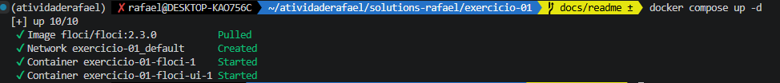
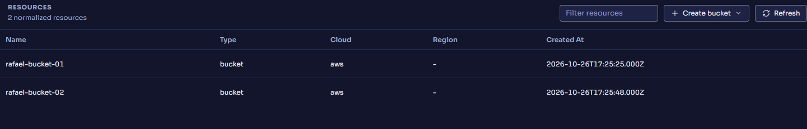

# Exercicio 1 - S3

1. Certifique-se de ter o Docker instalado e rodando.
2. No terminal, na raiz do projeto, execute: `docker compose up -d`
3. Os buckets S3 serão criados automaticamente pelo script na pasta `ready.d`.
4. Acesse a interface visual em `http://localhost:4500`.
5. Para desligar, execute `docker compose down`.
6. Verificar com curl `http://localhost:4566/_floci/init`
7. Resultado: `{"completed":{"boot":true,"start":true,"ready":true,"shutdown":false},"scripts":{"boot":[],"start":[],"ready":[{"return_code":0,"script":"/etc/floci/init/ready.d/criar-buckets.sh","state":"successful"}],"shutdown":[]}}`

# Solution

1. Saída do composer: 

2. Buckets:

