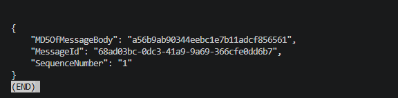
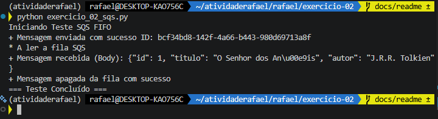

# Exercicio 2 - SQS FIFO

1. Certifique-se de que o ambiente Docker via `docker compose up -d` está ativo.
2. As filas SQS FIFO são configuradas automaticamente na inicialização pelos scripts da pasta `ready.d`.
3. Para validar as filas criadas, utilize os comandos AWS CLI com o endpoint local ou consulte a interface visual em `http://localhost:4500`.
4. O script `exercicio_02_sqs.py` foi atualizado para realizar o fluxo completo (end-to-end).
5. Execute o script com `python exercicio_02_sqs.py` para disparar uma mensagem de teste.
6. O script lê a mensagem automaticamente da fila.
7. O script remove a mensagem, concluindo o ciclo de vida.

## Para Pensar

* Por que usar FIFO? 
Garante que as mensagens são processadas estritamente na mesma ordem em que foram enviadas, algo crucial para transações em bancos de dados (ex: criar um livro antes de atualizar o seu status).
* Para que serve o MessageGroupId?
Garante a ordenação de mensagens dentro de um subgrupo específico. Mensagens com o mesmo `MessageGroupId` são processadas em ordem.
* Para que serve o MessageDeduplicationId? 
Evita que a mesma mensagem seja duplicada na fila (num intervalo de 5 minutos). Usar o `id` do livro como deduplicação impede a inserção de registos duplicados no sistema caso haja retentativas de rede acidentais.

# Solutions 2

1. Docker:

2. FastAPI criada:

3. Terminal:

