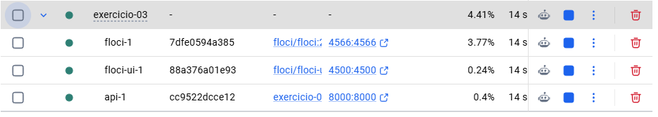
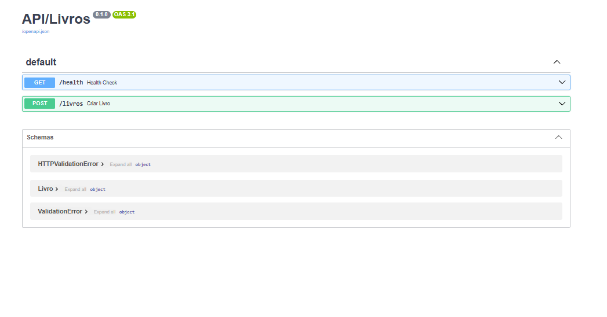

# Exercicio 03 - API Livros com SQS

1. Suba a infraestrutura completa (Floci e API) usando: `docker compose up -d --build`
2. A API iniciará automaticamente junto com o Docker. Acesse a documentação interativa em: `http://localhost:8000/docs`
3. Para rodar os testes, execute: `uv run pytest`
4. Para verificar o estilo do código, execute: `uv run ruff check .`

# Solutions 3

1. Docker:
q

1. Filas SQS FIFO:

