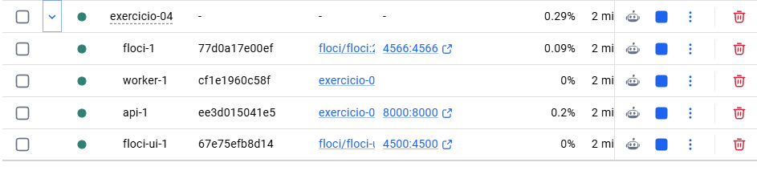
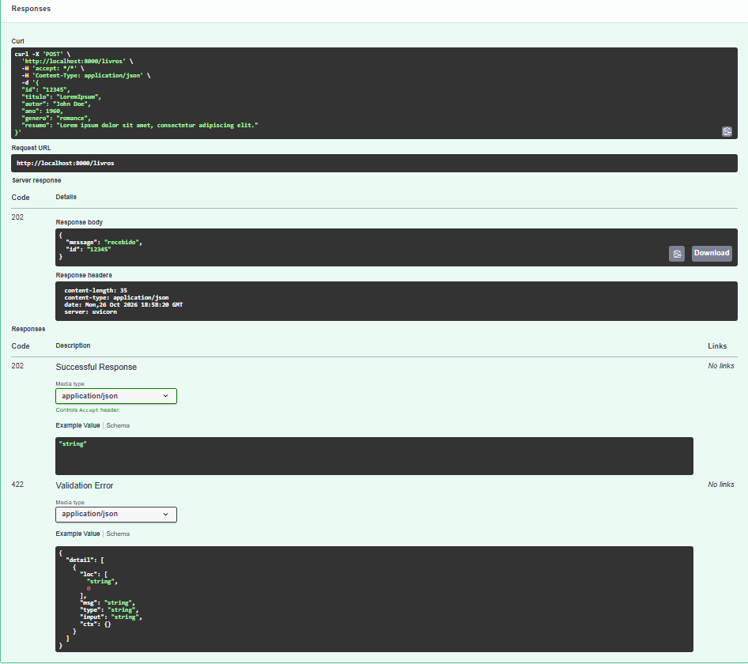
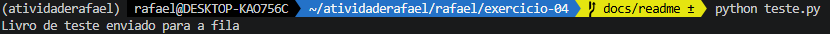
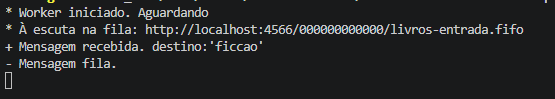

# Exercicio 04 - Filas SQS FIFO e Armazenamento S3

1. Suba a infraestrutura completa (Floci, SQS e S3) com `docker compose up -d --build`. O script de inicialização (`ready.d`) criará automaticamente as filas e os três buckets (`romance`, `ficcao`, `outros`).
2. Inicie o processador de mensagens (worker) executando `python app/worker.py` para consumir os dados da fila com *long polling* ativado.
3. Envie livros para a fila SQS FIFO para que o worker os processe e armazene automaticamente no bucket S3 correspondente à sua categoria.
4. Crie um test.py e rode.

# Solutions 4

1. Docker:

2. Fast Api:

3. Enviando:

4. Fila Recebendo:

