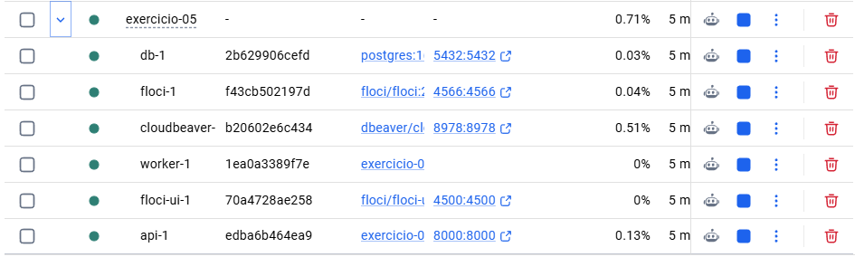
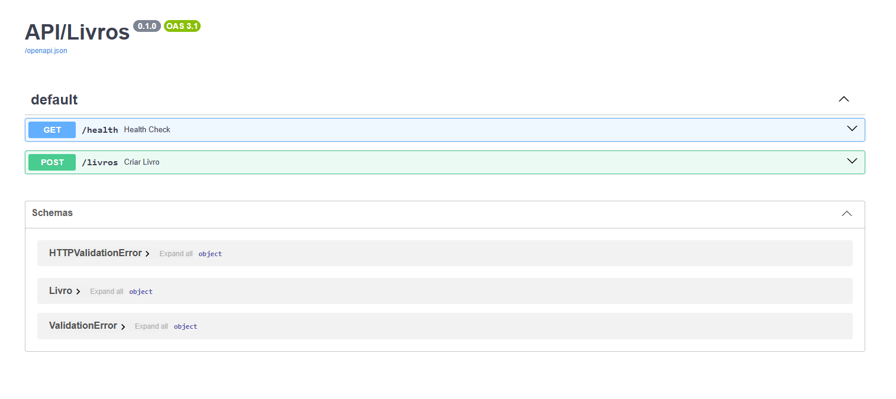
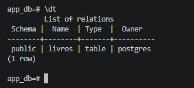

# Exercicio 05 - SQLModel

1. Instale as dependências e execute o script de integração em Python:
   ```bash
   uv add sqlmodel "psycopg[binary]"
   uv run python exercicio_05.py [uv run python app/exercicio_05.py]

# Solution 5

1. Docker:



2. FastApi:



3. Tabela:

