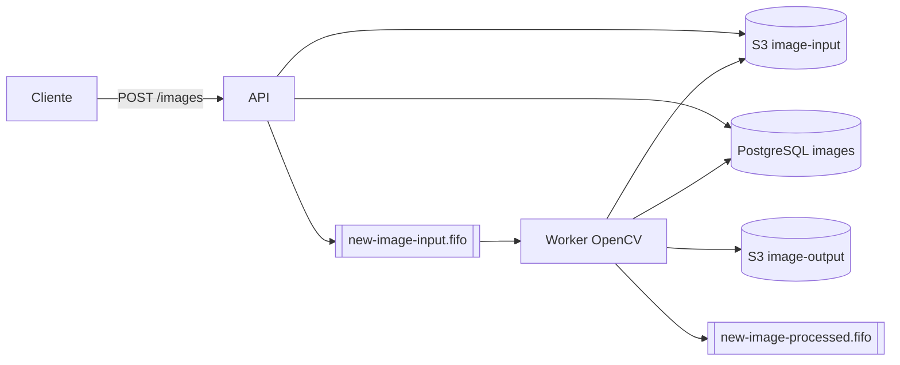
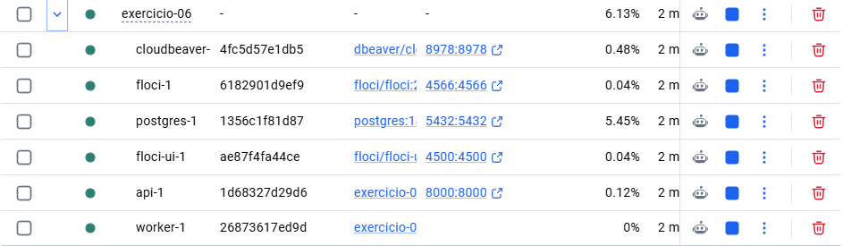
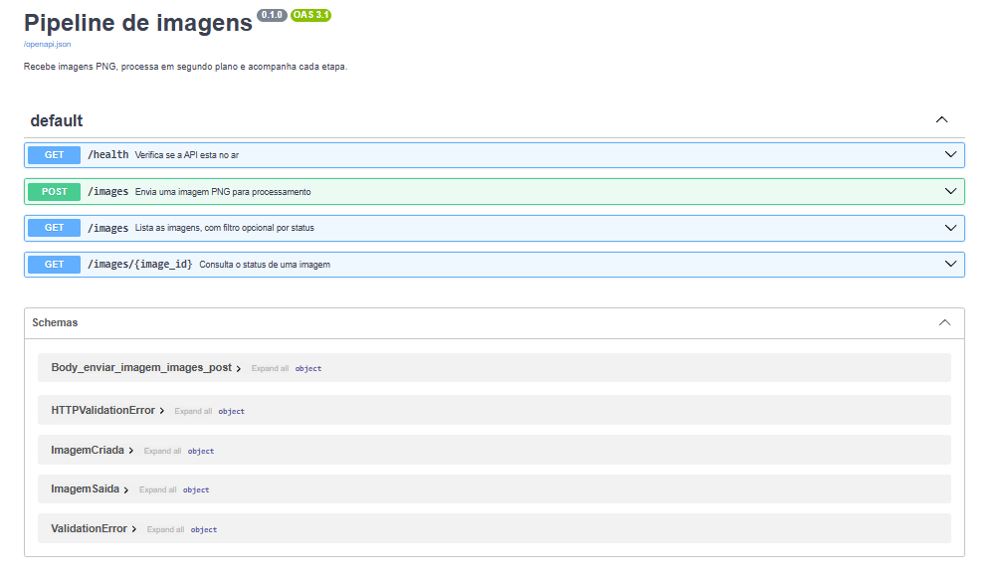
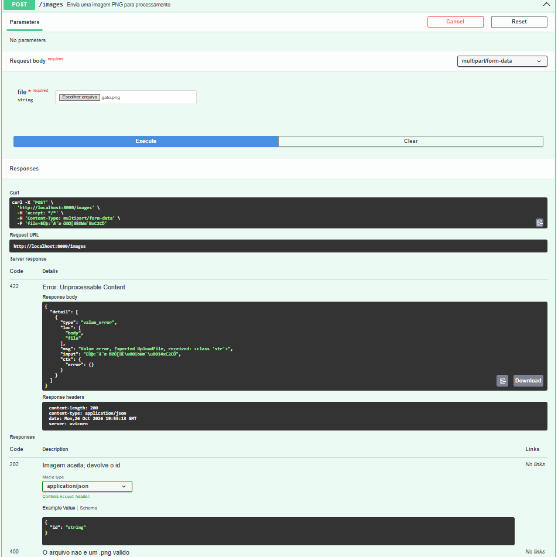

# Exercicio 06 - Pipeline de imagens

A API recebe um PNG, guarda no S3, registra no banco e avisa a fila. O worker processa com OpenCV, guarda o resultado e avisa que terminou.

1. Copie as variáveis de ambiente: `cp .env.example .env`
2. Suba tudo (API, worker, Floci, floci-ui, PostgreSQL e CloudBeaver): `docker compose up --build`
3. Verifique a API: `curl http://localhost:8000/health`
4. Envie uma imagem: `curl -F "file=@imagem.png" http://localhost:8000/images`
5. Consulte o status com o id devolvido: `curl http://localhost:8000/images/<id>`
6. Liste filtrando por status: `curl "http://localhost:8000/images?status=processada"`
7. Documentação OpenAPI: `http://localhost:8000/docs`
8. Buckets `image-input` e `image-output` no floci-ui: `http://localhost:4500`
9. Tabela `images` no CloudBeaver: `http://localhost:8978` (banco `vddb`)
10. Para rodar os testes, execute: `uv run pytest`

# Solution 6

1. Docker:

2. FastApi:

3. Enviar imagem:

